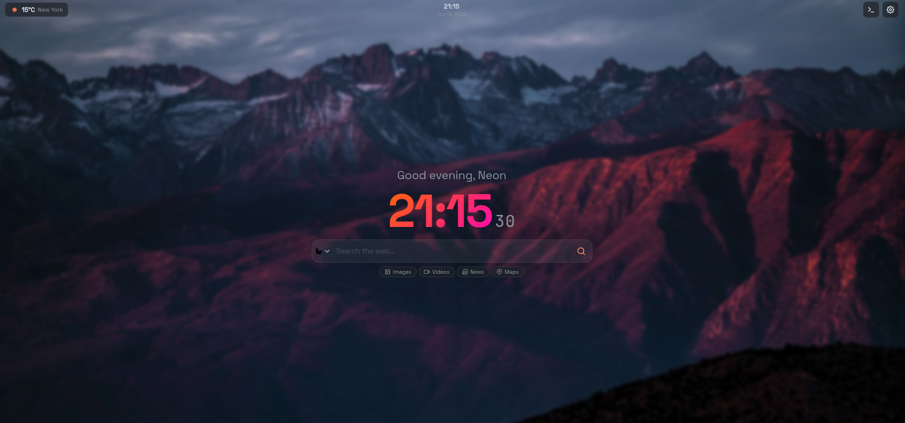
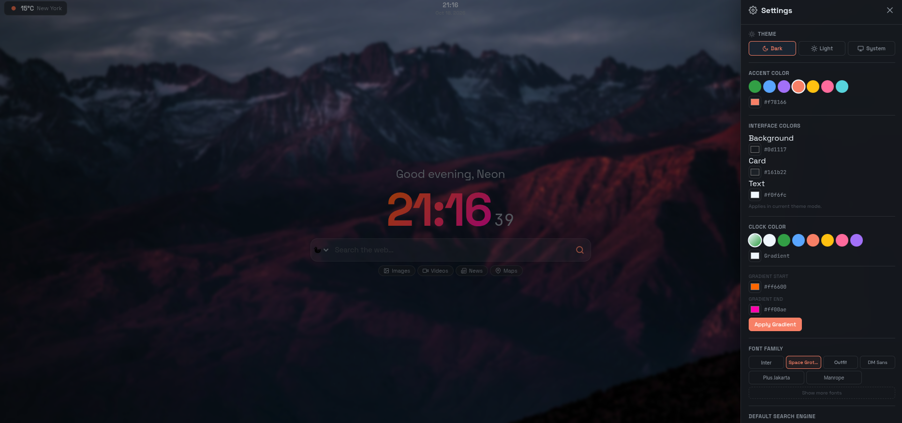
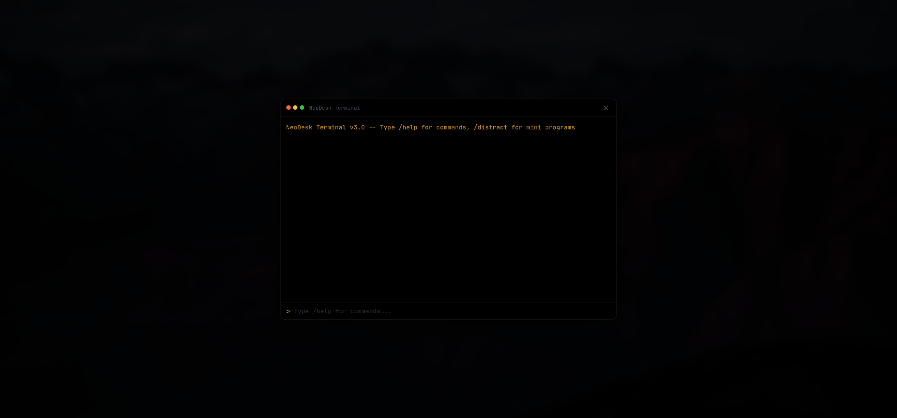

# ◈ NeoDesk

**Your browser. Your workspace. Your flow.**

Transform your new tab into a customizable productivity dashboard — with live weather, smart search, quick links, a built-in terminal, and a clean interface.

[](https://github.com/NeonMC23/NeoDesk) [](https://developer.mozilla.org/en-US/docs/Web/JavaScript) [](#-technology) [](LICENSE)

[**Launch NeoDesk**](https://neonmc23.github.io/NeoDesk/) · [Features](#-features) · [Getting Started](#-getting-started) · [Terminal](#-built-in-terminal) · [Privacy](#-privacy)

---

## ◈ Preview







*One tab. Everything you need to get started.*

---

## ✦ Features

| Feature | Description |
| --- | --- |
| 🕒 **Live clock** | Digital clock with seconds and 12-hour or 24-hour format. |
| 🌦️ **Weather** | Current weather through OpenWeatherMap, with a customizable city. |
| 🔎 **Smart search** | Switch between Google, DuckDuckGo, Bing, Brave, and Yahoo. |
| 💻 **Built-in terminal** | Access search shortcuts and dashboard commands with `Alt + T`. |
| ⭐ **Quick links** | Manage your favorite websites with editable shortcuts. |
| 🎨 **Themes** | Switch between dark, light, and system appearance. |
| 🖼️ **Custom backgrounds** | Choose gradient presets or use your own image or URL. |
| 🌫️ **Adjustable blur** | Fine-tune background blur for a more readable interface. |
| 🧩 **Customizable widgets** | Toggle weather, quotes, date, and favorites. |
| ⚙️ **Personal settings** | Configure clock format, temperature units, display name, and more. |
| 📱 **Responsive design** | Adapt the dashboard to different screen sizes. |
| 💾 **Local persistence** | Save preferences in your browser using `localStorage`. |

## ▸ Getting Started

### Requirements

- A modern web browser.
- Git, to clone the repository.
- An internet connection for online services such as weather and search.

No framework, package manager, or build process is required.

### 1. Clone the repository

```bash
git clone https://github.com/NeonMC23/NeoDesk.git
cd NeoDesk
```

### 2. Open NeoDesk

Open `index.html` in your browser.

For a more reliable local setup, start a simple HTTP server:

```bash
python3 -m http.server 5500
```

Then visit:

`http://127.0.0.1:5500/`

### 3. Use it as your new tab

To replace your browser's default new tab page, use a compatible new-tab extension or browser configuration.

For Chrome or Edge, you can configure a new-tab override extension to open your local NeoDesk page or the hosted version.

**Live version:** [neonmc23.github.io/NeoDesk](https://neonmc23.github.io/NeoDesk/)

---

## ⌨️ Keyboard Shortcuts

| Key | Action |
| --- | --- |
| `/` | Focus the search bar. |
| `Tab` | Switch the search engine. |
| `Enter` | Execute the search. |
| `Alt + T` | Open the built-in terminal. |
| `Esc` | Close open panels. |

## 💻 Built-in Terminal

Open the terminal with `Alt + T` and use commands to search, navigate, and manage dashboard options without leaving the page.

### Available commands

| Command | Description |
| --- | --- |
| `/g <query>` | Search Google. |
| `/yt <query>` | Search YouTube. |
| `/img <query>` | Search for images. |
| `/map <query>` | Open Google Maps results. |
| `/wiki <query>` | Search Wikipedia. |
| `/ddg <query>` | Search DuckDuckGo. |
| `/reddit <query>` | Search Reddit. |
| `/gh <query>` | Search GitHub. |
| `/s <query>` | Search with the default engine. |
| `/weather <city>` | Set the weather city. |
| `/theme <mode>` | Set the theme: `dark`, `light`, or `system`. |
| `/time` | Display the current time. |
| `/date` | Display the current date. |
| `/todo` | Open Todoist. |
| `/clear` | Clear the terminal. |
| `/help` | Display available commands. |

## ⚙️ Customization

NeoDesk keeps its settings in your browser, allowing you to personalize the dashboard without creating an account.

### Appearance

- Dark, light, or system theme.
- Gradient backgrounds or custom images.
- Adjustable blur intensity.

### Search

Choose between Google, DuckDuckGo, Bing, Brave, and Yahoo.

### Widgets

Enable or disable individual elements such as weather, quotes, date, and favorites.

### System preferences

- 12-hour or 24-hour clock.
- Celsius or Fahrenheit.
- Personalized display name.
- Reset to default settings.

## ⛭ Technology

| Component | Technology |
| --- | --- |
| Structure | HTML5 |
| Styling | CSS3, variables, Flexbox, Grid, animations |
| Application logic | Vanilla JavaScript (ES6+) |
| Weather | OpenWeatherMap API |
| Quotes | Quotable API with fallback |
| Persistence | Browser `localStorage` |

> No frameworks. No dependencies. No build tools.

## 🔒 Privacy

NeoDesk is designed to work without an account or a dedicated application backend.

- **No account system** is required.
- **No dedicated backend** is needed for dashboard preferences.
- **Settings** are stored locally in the browser using `localStorage`.
- **External services** are used for features such as weather, quotes, and web searches.

Keep in mind that searches and requests to external services may disclose information to those providers. Local settings do not mean that every network request is private or offline.

## 🌐 Deployment

NeoDesk can be hosted using GitHub Pages.

1. Push the repository to GitHub.
2. Open the repository's **Settings → Pages**.
3. Select the `main` branch and the repository root.
4. Save the configuration.

Once published, the dashboard is available at:

[https://neonmc23.github.io/NeoDesk/](https://neonmc23.github.io/NeoDesk/)

## 🗺️ Roadmap

Potential improvements planned for a future version:

- [ ] Plugin system.
- [ ] Notes widget.
- [ ] Calendar widget.
- [ ] Drag-and-drop layout editor.
- [ ] Export and import settings.
- [ ] Multiple profiles.

These are planned ideas, not features currently guaranteed to be available.

## 🤝 Contributing

Suggestions, bug reports, and improvements are welcome.

- Report bugs.
- Suggest new features.
- Improve the interface and user experience.
- Propose new widgets.
- Optimize performance.

Open an issue to discuss a significant change before submitting a pull request.

## 📄 License

NeoDesk is distributed under the [MIT License](LICENSE).

---

*Less clutter. More focus.*

**NeoDesk — Make every new tab count.**
